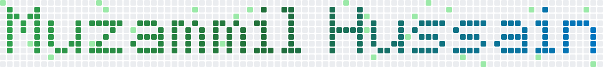
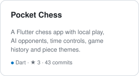
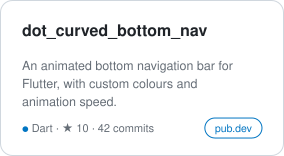
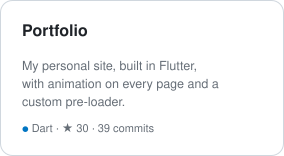

  <picture><source media="(prefers-color-scheme: dark)" srcset="https://raw.githubusercontent.com/Muzammil-Bit/Muzammil-Bit/output/title-dark.svg"></picture>

  <picture><source media="(prefers-color-scheme: dark)" srcset="https://raw.githubusercontent.com/Muzammil-Bit/Muzammil-Bit/output/snake-dark.svg"></picture>

  <picture><source media="(prefers-color-scheme: dark)" srcset="https://raw.githubusercontent.com/Muzammil-Bit/Muzammil-Bit/output/stats-dark.svg"></picture>

## Things I've built

  <a href="https://github.com/Muzammil-Bit/pocket_chess"><picture><source media="(prefers-color-scheme: dark)" srcset="https://raw.githubusercontent.com/Muzammil-Bit/Muzammil-Bit/output/project-pocket-chess-dark.svg"></picture></a>

  <a href="https://pub.dev/packages/dot_curved_bottom_nav"><picture><source media="(prefers-color-scheme: dark)" srcset="https://raw.githubusercontent.com/Muzammil-Bit/Muzammil-Bit/output/project-dot-curved-bottom-nav-dark.svg"></picture></a>

  <a href="https://heymuzammil.com"><picture><source media="(prefers-color-scheme: dark)" srcset="https://raw.githubusercontent.com/Muzammil-Bit/Muzammil-Bit/output/project-portfolio-dark.svg"></picture></a>

  Also contributing to <a href="https://github.com/flutter/flutter/pulls?q=author%3AMuzammil-Bit">Flutter</a> and <a href="https://github.com/pingdotgg/t3code/pulls?q=author%3AMuzammil-Bit">T3 Code</a>.

## Find me

  <a href="https://heymuzammil.com"><picture><source media="(prefers-color-scheme: dark)" srcset="https://raw.githubusercontent.com/Muzammil-Bit/Muzammil-Bit/output/button-portfolio-dark.svg"></picture></a>
  <a href="https://www.linkedin.com/in/muzammil-developer/"><picture><source media="(prefers-color-scheme: dark)" srcset="https://raw.githubusercontent.com/Muzammil-Bit/Muzammil-Bit/output/button-linkedin-dark.svg"></picture></a>
  <a href="mailto:muzammil0301@gmail.com"><picture><source media="(prefers-color-scheme: dark)" srcset="https://raw.githubusercontent.com/Muzammil-Bit/Muzammil-Bit/output/button-email-dark.svg"></picture></a>

