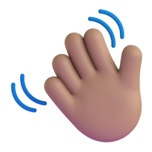
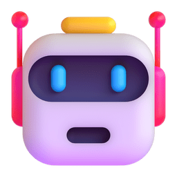
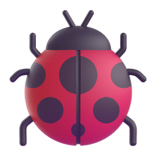
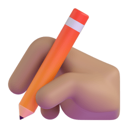
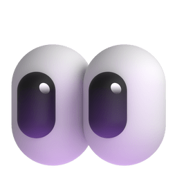

 &nbsp;
 &nbsp;
 &nbsp;

##  &nbsp;Hi there! I'm Muzammil Hussain

<h4>Mobile developer from Lahore building Flutter apps end to end: the animated UI people touch, and the .NET, Node or Laravel backend and AI features behind it.</h4>

<ul>
<li>&nbsp; Building cross-platform apps with Flutter, plus web with Next.js and Astro.</li>
<li>&nbsp; Fairly obsessed with motion. If a screen can animate, I've probably tried.</li>
<li>&nbsp; Lately shipping AI-assisted flows in production apps, and using AI agents to build faster.</li>
<li>&nbsp; Contributing to <a href="https://github.com/flutter/flutter/pulls?q=author%3AMuzammil-Bit">Flutter</a> and <a href="https://github.com/pingdotgg/t3code/pulls?q=author%3AMuzammil-Bit">T3 Code</a>.</li>
<li>&nbsp; On a mission to fix bugs I proudly introduced.</li>
<li>&nbsp; Open to freelance work. Reach me at <a href="mailto:muzammil0301@gmail.com">muzammil0301@gmail.com</a>.</li>
</ul>

## &nbsp; Showcase projects

<table>
  <tr>
    <td width="50%">
      
    </td>
    <td width="50%">
      
    </td>
  </tr>
  <tr>
    <td colspan="2" align="center">
      
    </td>
  </tr>
</table>

## &nbsp; Like my work?

&nbsp; [Check out my portfolio](https://heymuzammil.com) 
&nbsp; [Follow along on LinkedIn](https://www.linkedin.com/in/muzammil-developer/) 
&nbsp; [Hire me for your next app](mailto:muzammil0301@gmail.com)

## &nbsp; GitHub stats

&nbsp;&nbsp;

Animated icons from <a href="https://github.com/Tarikul-Islam-Anik/Animated-Fluent-Emojis">Animated Fluent Emojis</a> (Microsoft Fluent Emoji, MIT).
